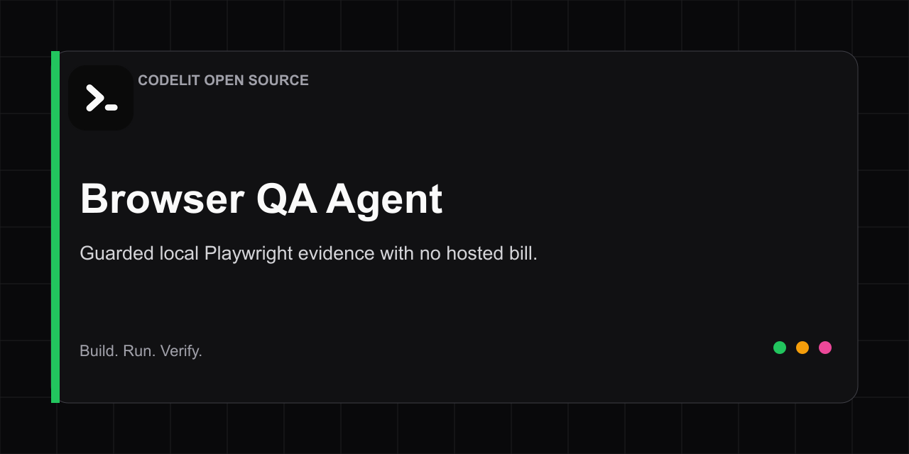

# Browser QA Agent



A guarded local Playwright runner that captures a screenshot, visible page
structure, console errors, failed requests, overflow candidates, and unlabeled
controls. It needs no Codelit account, AI key, extension, or hosted browser.

[Open the visual browser team in Codelit](https://codelit.io/agents/openclaw-browser-operations-agent?sample=1&source=github&utm_source=github&utm_medium=repository&utm_campaign=github_open_source&utm_content=browser-qa-agent) |
[Browser Operator documentation](https://codelit.io/docs/browser-operator?utm_source=github&utm_medium=repository&utm_campaign=github_open_source&utm_content=browser-qa-agent) |
[Browse Agent Teams](https://codelit.io/agents?utm_source=github&utm_medium=repository&utm_campaign=github_open_source&utm_content=browser-qa-agent)

## Run a public-page audit

```bash
npm install
npm run setup
npm run audit -- https://codelit.io --output artifacts/codelit
```

Open `artifacts/codelit/report.md` beside `artifacts/codelit/page.png`.

## Safety boundary

- Uses a new, unsigned, ephemeral browser context for every run.
- Allows only the target host plus exact hosts passed with `--allow-host`.
- Requires HTTPS unless `--allow-http` is explicit.
- Blocks private and local network destinations by default.
- Blocks browser requests other than GET, HEAD, and OPTIONS.
- Captures one fixed viewport instead of an unbounded full-page image.

Local development fixtures require both `--allow-http` and
`--allow-private-network`. This public runner does not load saved sessions,
sign in, fill forms, click controls, or make writes. Codelit Pro adds managed,
resizable browser sessions, approvals, signed-in access, hosted schedules, and
durable Run Receipts.

## Verify

```bash
npm run setup
npm run verify
```

## License

MIT
